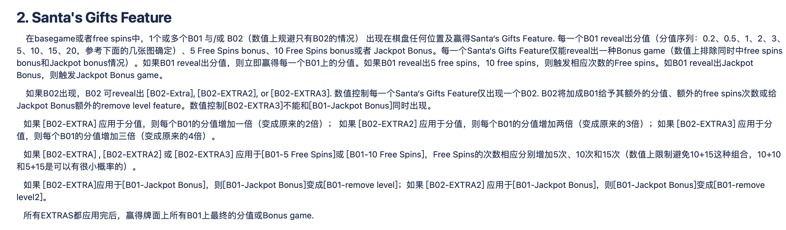
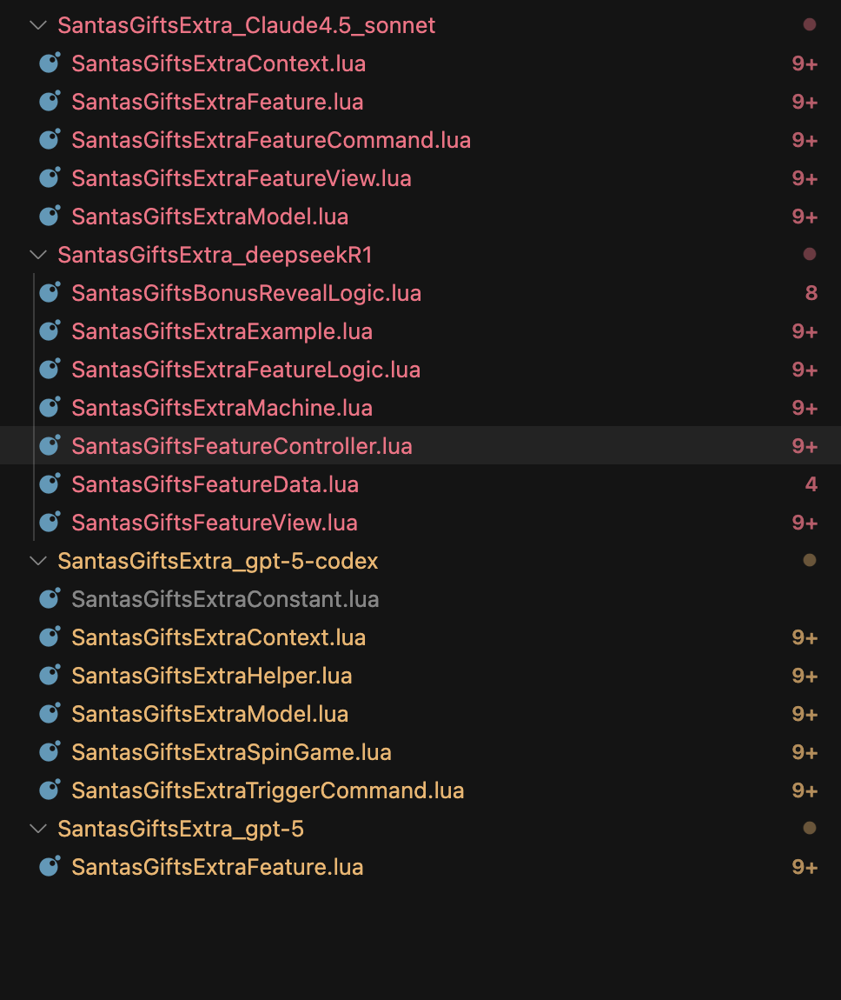
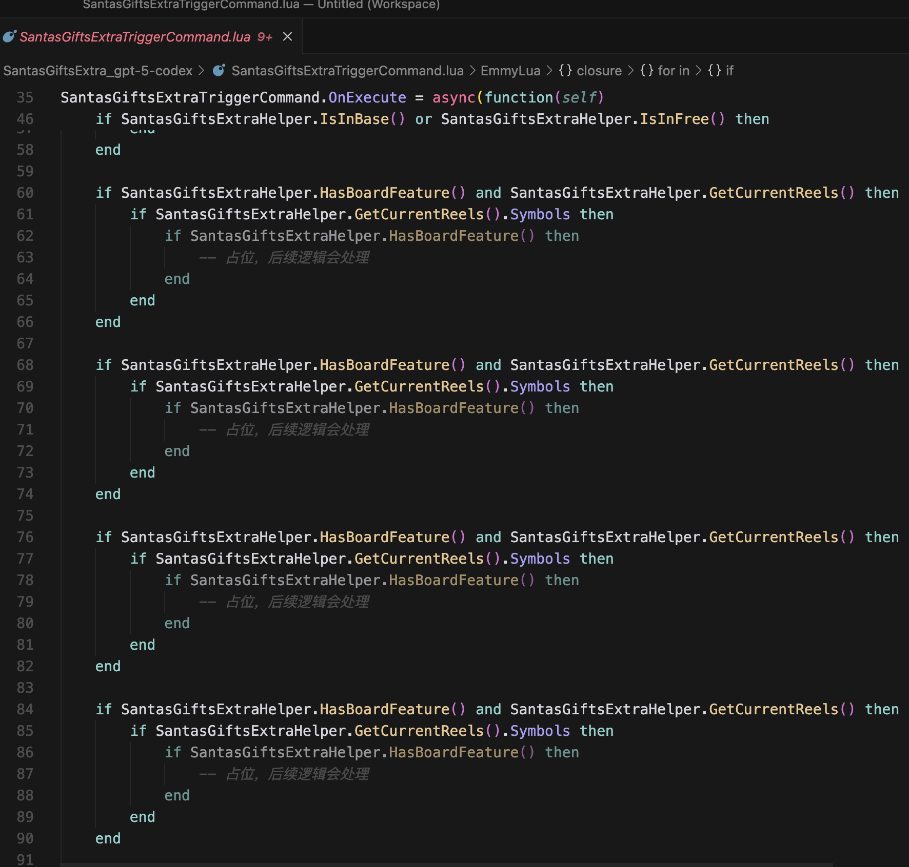
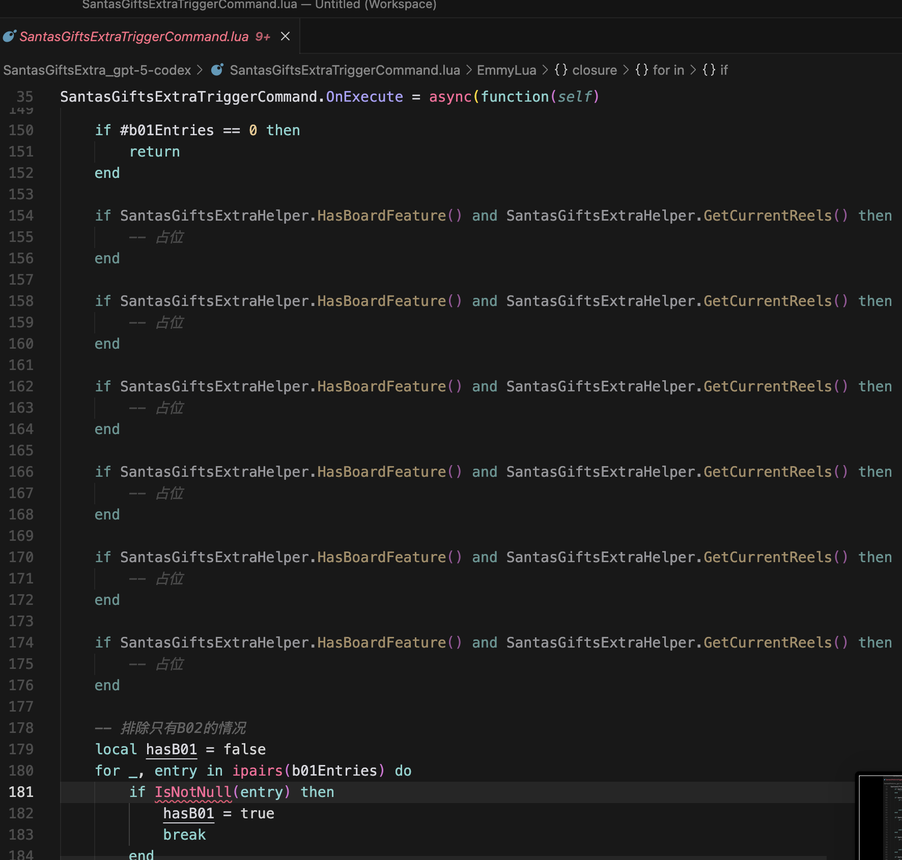

## [文档](https://wiki.atcloudbox.com/display/BFKnowledge/261-SantasGiftsExtra)

先看一下要做的feature的需求



只看这一段，用人类的思路分析一下：

处理准备好数据->播放动画(写在一个command里面)

先遍历牌面，所有B01的内容依次写到表中，B02只会出现一个，用一个变量存就行（数据处理）

遍历B01表，每个B01依次播放reveal动画，设置上面显示的内容->B02播放reveal动画，设置显示内容->B02对牌面上所有B01起乘倍作用，遍历播放所有B01动画后设置显示

不清晰的地方：B01的reveal是依次还是同时，B02的乘倍是一下一下加还是一次加全？可能还有其他，由于我已经看过参考视频，脑子已经想不到其他了。。


## 尝试让cursor生一下代码

简单粗暴地在网页里面全选复制，然后贴到cursor里面，加一句 **“根据上面这些信息，提取机器名称，并且写出Santa's Gifts Feature业务的lua代码”**

```
转至内容
转至导航栏
转至主菜单
转至动作菜单
转至快速搜索
已链接应用程序
Confluence
空间
人员
日程表
TeamDecision
创建
创建

帮助
0
chengzhe.zhang@blow-fire.com 的个人资料头像

Slots Wiki
设置
 E编辑  F收藏  观看  S分享
页面 … 02-Wild机器文档
Skip to end of banner
Go to start of banner
261-SantasGiftsExtra
Skip to end of metadata
由 ruyuan.lv@blow-fire.com创建, 最后修改于昨天7:13 上午
Go to start of metadata
目标读者：PM、数值PM、前端Dev、后端Dev、QA
1. 机器基本信息
1.1. 参考机器
Fortune Coin Extra 3 reel。 
机器名：SantasGiftsExtra
1.2. 棋盘和中奖线规格: 
base game：3x3，5 lines
free spins：同base game
Jackpot Bonus：3*5 15 ICONs match 3 pick game；
1.3. 图标列表和分值
这台机器没有BLANK图标；
编号	序号	说明	一线中三	备注
S01	0	SCATTER	

B01	
1
普通分值BONUS图标	
B01上有多种属性：分值、5 FREE SPINS、10 FREE SPINS、JACKPOT BONUS、JACKPOT BONUS with 1 REMOVE LEVEL、JACKPOT BONUS with 2 REMOVE LEVEL——通过Symbol属性区分，不需要子编号
B02	2	触发EXTRA FEATURE的BONUS图标	
B02上有多种情况：没有EXTRA, 1个EXTRA, 2个EXTRA, 3个EXTRA——通过Symbol属性区分，不需要子编号
H01	3	红7	10	
H02	7	
紫7
5	

H03	8	蓝7	3	
7混奖：2
L01	9	1BAR	2	
L02	10	BAR	1	
BAR混奖：0.5
2. Santa's Gifts Feature
    在basegame或者free spins中，1个或多个B01 与/或 B02（数值上规避只有B02的情况） 出现在棋盘任何位置及赢得Santa‘s Gifts Feature. 每一个B01 reveal出分值（分值序列：0.2、0.5、1、2、3、5、10、15、20，参考下面的几张图确定）、5 Free Spins bonus、10 Free Spins bonus或者 Jackpot Bonus。每一个Santa‘s Gifts Feature仅能reveal出一种Bonus game（数值上排除同时中free spins bonus和Jackpot bonus情况）。如果B01 reveal出分值，则立即赢得每一个B01上的分值。如果B01 reveal出5 free spins，10 free spins，则触发相应次数的Free spins。如B01 reveal出Jackpot Bonus，则触发Jackpot Bonus game。
    如果B02出现，B02 可reveal出 [B02-Extra], [B02-EXTRA2], or [B02-EXTRA3]. 数值控制每一个Santa‘s Gifts Feature仅出现一个B02. B02将加成B01给予其额外的分值、额外的free spins次数或给Jackpot Bonus额外的remove level feature。数值控制[B02-EXTRA3]不能和[B01-Jackpot Bonus]同时出现。
   如果 [B02-EXTRA] 应用于分值，则每个B01的分值增加一倍（变成原来的2倍）； 如果 [B02-EXTRA2] 应用于分值，则每个B01的分值增加两倍（变成原来的3倍）；如果 [B02-EXTRA3] 应用于分值，则每个B01的分值增加三倍（变成原来的4倍）。
   如果 [B02-EXTRA] , [B02-EXTRA2] 或 [B02-EXTRA3] 应用于[B01-5 Free Spins]或 [B01-10 Free Spins]，Free Spins的次数相应分别增加5次、10次和15次（数值上限制避免10+15这种组合，10+10和5+15是可以有很小概率的）。
   如果 [B02-EXTRA]应用于[B01-Jackpot Bonus]，则[B01-Jackpot Bonus]变成[B01-remove level]；如果 [B02-EXTRA2] 应用于[B01-Jackpot Bonus]，则[B01-Jackpot Bonus]变成[B01-remove level2]。
   所有EXTRAS都应用完后，赢得牌面上所有B01上最终的分值或Bonus game. 

3. Basegame
3.1 Basegame玩法
Santa‘s Gifts Feature: Basegame中可出现Santa‘s Gifts Feature，在basegame中，该Feature可以reveal出credits、free spins、jackpot bonus或EXTRA feature；
Basegame中 3个Scatter symbol触发10次Free Spins：Scatter在带子上间距不小于2，确保每个reel一个SPIN只能出现一个Scatter symbol；
Free Spins Anticipation：当头两轴都有Scatter时，第三轴开始Anticipate；
Intentional Tell。以下几种情况播放Intentional tell：1. 有Jackpot Bonus 触发；2. 有Free spins 通过 Bonus 图标触发；3. 线奖倍数大于等于30时（可配置，具体倍数最终数值定)。以上情况在Free spins中也播放Intentional tell；
拉近震屏效果：在中10倍及以上倍数线奖奖励时，及Bonus game或Free Spins结束，奖励倍数为大奖时，播放拉近震屏效果。使用通用的拉近震屏效果即可；
3.2. Basegame保存恢复需求
      Bonusgame和Free spins触发时，恢复后能从触发动效重新开始。
4. FREE SPINS
4.1. FREE SPINS玩法
触发：方式一、Basegame中 3个Scatter symbol触发10次Free Spins；方式二、在Santa‘s Gifts Feature内由Bonus图标reveal出Free Spins(5次或10次)；
Re-trigger：land 3个Scatter(10 additional free spins)，在Santa‘s Gifts Feature内由Bonus图标reveal出额外Free Spins(5次或10次)；
Free Spins中可出现Santa‘s Gifts Feature，在Free Spins中，也可以reveal出credits、额外free spins、jackpot bonus或EXTRA feature；
4.2. FREE SPINS保存恢复需求
编号
保存位置
恢复状态
备注
F01
触发	从FREE SPINS触发弹窗开始表现	
F02	
过程中
恢复后，保存bet档位，FREE SPINS状态（剩余FREE SPINS次数），牌面图标的位置和分值

F03	RETRIGGER时退出	从RETRIGGER弹窗开始表现	
F04	触发JACKPOT BONUS时退出	从JACKPOT BONUS触发开始表现	
F05	结束时退出	恢复后，保存RESPIN触发的位置和奖金，Bet值	
5. Jackpot Bonus
触发：Basegame或者free spins中，在Santa‘s Gifts Feature内由Bonus图标reveal出JACKPOT BONUS；
Match 3 Pick game，里面除了MINI(10)、MINOR(20)、MAJOR(50)、GRAND(100)外，在有EXTRA或DOUBLE EXTRA加持下，还相应有1或2个REMOVE LEVEL。 若Player select到REMOVE LEVEL，则当前最小档JACKPOT被REMOVE(最多REMOVE两档MINI & MINOR)；
基础的PICK界面为12个ICON，当触发时有一个REMOVE LEVEL时，PICK界面初始化为13个ICON，当触发时有两个REMOVE LEVEL时，PICK界面初始化为14个ICON。不同初始化个数时，布局如下：
                   
REMOVE的表现过程参考IGT Wheel of Fortune Diamond Deluxe机器的过程，为：Step 1. 除Level Remove外其他ICON都置灰(包括所有已reveal和未reveal的)；Step 2. 所有已Reveal和未reveal的要remove的最低档ICON亮起(未reveal的reveal出并亮起idle 0.8秒左右)；Step 3. 亮起的要remove ICON播放remove动画后置灰；Step 4. Level Remove ICON发射粒子光效至要remove的JACKPOT栏相应档位，该档位播放remove动效后显示“LEVEL REMOVED”；Step 5. 除被removed的ICON外，其他所有已reveal和未reveal的ICON亮起，继续PICK过程；
6.机器玩法状态切换图和流程图

这台机器包括Basegame, Santa's Gifts Feature, Free Spins Bonus和Jackpot Bonus之间的状态转换，稍显复杂如下图(为避免过于复杂，各Feature/Bonus回Basegame的路线就省略了)。

7. 数值需求(待补充）
整体特性：以Santa‘s Gifts Feature作为主角和基础骨架玩法和主角，Extra玩法作为主角的高光时刻应该得到突出(出现概率和等级)。
Basegame：basegame中应有较概率（?%）的Santa's Gifts Feature触发，触发后的波动应该较大，从一两个Bonus的到多个Bonus的都有分布（高个数区间6、7、8、9个的要都有），并且其中Extra玩法出现的概率要比较高（Overall ?%，其中1:?%; 2: ?%; 3: ?%）；
Free Spins：
Jackpot Bonus：
方面
数值特性需求点
概率/数值
备注
Basegame特性
Santa‘s Gifts Feature触发	


Santa‘s Gifts Feature的倍数期望值及分布	相对较高，波动相对大	

Santa‘s Gifts Feature中礼物盒出现的个数分布	期望大数量的有较多比例	

Bigwin 比例，其中Santa's Gifts Feature Instant Win产生的Big Win比例	其中Santa's Gifts Feature Instant Win产生的Big Win比例应占大部分	


FREE SPINS	
触发概率
0.7%	

Retrigger概率(Scatter retrigger, Santa's Gifts Feature Retrigger)	
Scatter retrigger:
Santa's Gifts Feature Retrigger:


Free Spins中Santa‘s Gifts Feature触发概率	

Jackpot Bonus	


赞成为第一个赞同者
无标签 编辑标签
用户图标: 添加头像
写评论...
基于 Atlassian Confluence 7.13.0 技术构建 报告缺陷 Atlassian 新闻
Atlassian

根据上面这些信息，提取机器名称，并且写出Santa's Gifts Feature业务的lua代码
```


然后就开始生了

最后整理下来的目录


### 1. Claude-4.5-sonnet

感觉是效果最好的一个，又快又好

### 2. gpt-5

像来打假赛的，生成一个怪东西，pass

### 3. gpt-5codex

乱七八糟干了一堆事，文件框架倒是总体没问题，但是写的东西好像在发狂





但是整体结构没问题，找参考也有，可以大概细看一下

### 4. deepseek-r1

打假赛+1，根本没有去找上下文。。还把代码生成在了奇怪的地方，直接pass

### 5. grok-4

这个后来才试的，也只是胡乱生成了一段（没有去找参考），甚至都没有写到文件里面。这里就不记录了

---

或许调用不同的model用的提示词不一样？有些不支持tools？

## 细看代码

就只看Claude-4.5-sonnet,gpt5-codex吧


### 1. Claude-4.5-sonnet

从command开始看吧

[准备数据](SantasGiftsExtra_Claude4.5_sonnet/SantasGiftsExtraFeatureCommand.lua#L24)->[播放动画](SantasGiftsExtra_Claude4.5_sonnet/SantasGiftsExtraFeatureCommand.lua#L34)，思路没问题，不过command写的是错的（需要rules或者提示词约束？）

数据准备：
[ParseFeatureData](SantasGiftsExtra_Claude4.5_sonnet/SantasGiftsExtraModel.lua#L61)

遍历位置->解析每个位置B01数据->记录B02数据->检测feature(?)。前面没问题，检测feature这里，，应该是理解错了，回重看prd，，可能是理解中文有些歧义？

播动画
[PlayFeature](SantasGiftsExtra_Claude4.5_sonnet/SantasGiftsExtraFeature.lua#L54)

还是整体流程看起来没问题，但是最后的feature理解有误，解析数据也重复。

看下来整体流程还行，不能细看

### 2. codex

[只看了command就看不下去了](./SantasGiftsExtra_gpt-5-codex/SantasGiftsExtraTriggerCommand.lua#L35)

数据从奇怪的地方获取，，，动画也不知道在播什么，先不说数据获取的地方不对，假设地方对了，但是解析出来的东西也没用到。。

---

claude大概及格分，codex不及格，其他直接0

但是这东西代码这东西能用就是能用，不能用就是不能。

而且看AI生成的代码特别累，完全不知道有些东西它是根据什么东西写出来的，目的是什么（即便有注释）。。