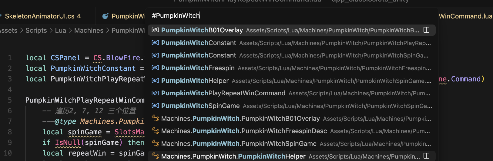
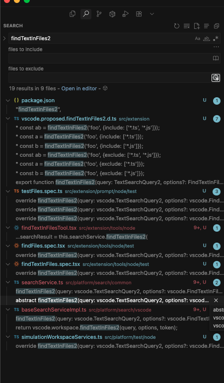
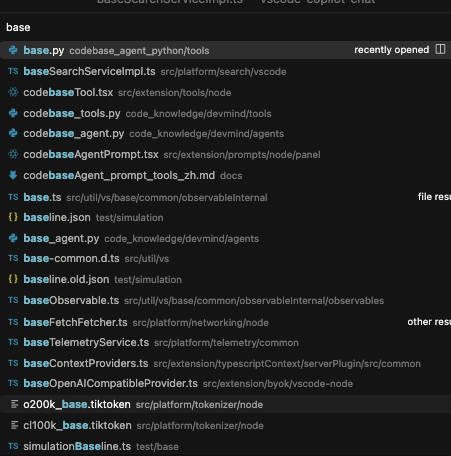

## [提示词](https://github.com/microsoft/vscode-copilot-chat/tree/main/src/extension/prompts/node/panel/codebaseAgentPrompt.tsx)


```
A developer needs to find some code in their codebase so that they can resolve a question or complete a task. You have full access to their codebase and can run tools to find code in it. Their request may contain hints for some of the files needed. It may require just one tool or many tools to collect the full context required.<br />
```
提示词设计原则：agent职责单一，只负责代码搜索与上下文搜集，不处理其他业务

```
Use `{ToolName.Codebase}` to search for high level concepts or descriptions of functionality in the user's question.{!isCodesearchFast && ` Note that '${ToolName.Codebase}' is slow, so you should only run it if you are confident its results will be relevant.`}<br />
Prefer `{ToolName.SearchWorkspaceSymbols}` over `{ToolName.FindTextInFiles}` when you have precise code identifiers to search for.<br />
Prefer `{ToolName.FindTextInFiles}` over `{ToolName.Codebase}` when you have precise keywords to search for.<br />
```
工具选择规则描述需要清晰，这里给不同工具定义了优先级，确保搜索效率

```
Remember that you can call multiple tools in one response.<br />
If you think running multiple tools can answer the user's question, prefer calling them in parallel whenever possible, but do not call `{ToolName.Codebase}` in parallel.<br />
```
某些工具可以并行调用，加速上下文搜集

所有用到的tool:

1. ReadProjectStructure
2. Codebase
3. SearchWorkspaceSymbols
4. FindTextInFiles
5. FindFiles
6. GetScmChanges

调用优先级：SearchWorkspaceSymbols>FindTextInFiles>Codebase


## 各种工具提供的数据

### 1. [ReadProjectStructure](https://github.com/microsoft/vscode-copilot-chat/tree/main/src/extension/tools/node/readProjectStructureTool.ts)

阅读一下目录，给出一个文件目录树

src/extension/prompts/node/panel/workspace/workspaceStructure.tsx 103 prepare

MultirootWorkspaceStructure.prepare:line 107->workspaceVisualFileTree:line 127->buildFileList:line 131

### 2. [Codebase](https://github.com/microsoft/vscode-copilot-chat/tree/main/src/extension/tools/node/codebaseTool.tsx)

fullWorkspaceResults->_codeSearchChunkSearch->_embeddingsChunkSearch->_tfIdfWithSemanticChunkSearch

#### 2.1 [全工作区搜索](https://github.com/microsoft/vscode-copilot-chat/tree/main/src/platform/workspaceChunkSearch/node/fullWorkspaceChunkSearch.ts)

单纯的读取所有文件，名称+内容，直接读，如果超了token就直接报错，交给下一个搜索策略

#### 2.2 [代码搜索](https://github.com/microsoft/vscode-copilot-chat/tree/main/src/platform/workspaceChunkSearch/node/codeSearchChunkSearch.ts)


这个好像是和github仓库有关的，大概是 https://github.com/features/code-search 这个服务 ，如果仓库里面没有或者和远程仓库差异过大，就会回退到tf-idf搜索等，，，反正最后也会带tf-idf

#### 2.3 [嵌入向量搜索](https://github.com/microsoft/vscode-copilot-chat/tree/main/src/platform/workspaceChunkSearch/node/embeddingsChunkSearch.ts)

这个应该类似llama_index的rag的向量搜索，这里直接复用了这个model来计算embedding，(默认用text-embedding-3-small-512)


#### 2.4 [tf-idf+语义搜索](https://github.com/microsoft/vscode-copilot-chat/tree/main/src/platform/workspaceChunkSearch/node/tfidfWithSemanticChunkSearch.ts)

先用tf-idf搜索一遍，然后再把这个结果和问题进行向量比对，返回语义相似度高的
查找tf-idf搜索结果中和xx代码块有交集的。。这个没懂和什么代码块算交集


#### 2.5 [tf-idf搜索](https://github.com/microsoft/vscode-copilot-chat/tree/main/src/platform/workspaceChunkSearch/node/tfidfChunkSearch.ts)

这个东西的搜索有点麻烦，在workspaceFileIndex里面调用[workspaceServiceImpl](https://github.com/microsoft/vscode-copilot-chat/tree/main/src/platform/workspace/vscode/workspaceServiceImpl.ts)建立索引   

initializeWorkspaceFiles进行数据准备

doTfidfSearch进行搜索，调用_tfIdfWorker进行搜索，这个worker又调用了[tfidf.ts](https://github.com/microsoft/vscode-copilot-chat/tree/main/src/platform/tfidf/node/tfidf.ts)进行搜索

对所有chunk 带上query进行一个评分，然后堆排序

----
tfidf总结：

计算目标：termTfIdf(查询中term的重要性) * chunkTfidf(文档中term的重要性)

chunkTfidf = chunkTf * chunkIdf

termTfidf = term在当前query中的出现频数 * chunkIdf

chunkTf = 当前term在当前chunk中的出现频数

chunkIdf = log(( 总chunk数 + 1) / 当前词在所有chunk中的出现次数)

tfidf = 当前term在chunk中出现的次数 * 在query中出现次数 * chunkIdf的平方。而二者重要性的乘积可以放大关键特征。若一个term在查询和文档中同时高频出现，且在全局中稀有，则乘积会显著放大其得分，反之则会抑制。


### 3. [SearchWorkspaceSymbols](https://github.com/microsoft/vscode-copilot-chat/tree/main/src/extension/tools/node/searchWorkspaceSymbolsTool.tsx)

在[languageFeaturesServicesImpl](https://github.com/microsoft/vscode-copilot-chat/tree/main/src/platform/languages/vscode/languageFeaturesServicesImpl.ts)中调用了vscode的内置方法



也就是这个搜索结果(变量，函数这些符号)

### 4. [FindTextInFiles](https://github.com/microsoft/vscode-copilot-chat/tree/main/src/extension/tools/node/findTextInFilesTool.tsx)

从[baseSearchServiceImpl](https://github.com/microsoft/vscode-copilot-chat/tree/main/src/platform/search/vscode/baseSearchServiceImpl.ts)中获取搜索结果，调用了findTextInFiles2，



### 5. [FindFiles](https://github.com/microsoft/vscode-copilot-chat/tree/main/src/extension/tools/node/findFilesTool.tsx)

调用[baseSearchServiceImpl](https://github.com/microsoft/vscode-copilot-chat/tree/main/src/platform/search/vscode/baseSearchServiceImpl.ts)的findFiles，也就是vscode.workspace.findFiles2



### 6. [GetScmChanges](https://github.com/microsoft/vscode-copilot-chat/tree/main/src/extension/tools/node/scmChangesTool.ts)

scmChangesTools的line 65主要就是从git上读了一下changes信息封装了一下

调用[gitServiceImpl](https://github.com/microsoft/vscode-copilot-chat/tree/main/src/platform/git/vscode/gitServiceImpl.ts),从vscode扩展里面调用git api获取repo数据

```typescript
let gitExtension = vscode.extensions.getExtension<GitExtension>('vscode.git');
```


